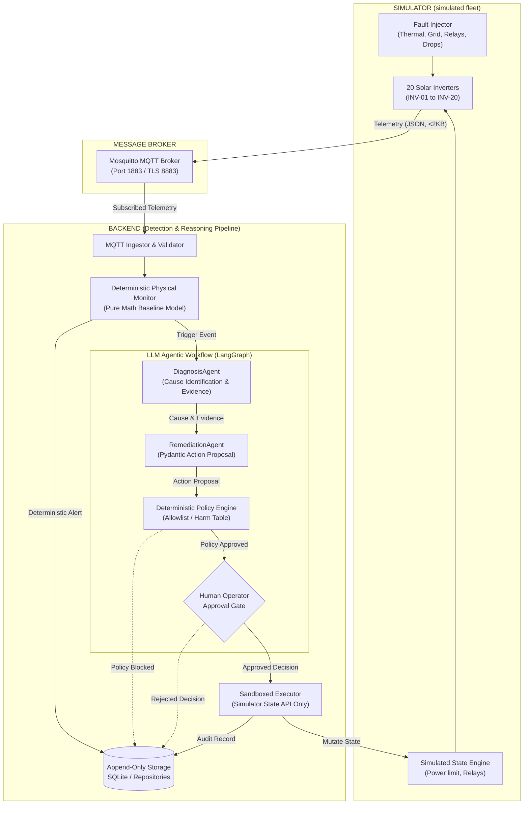

# IoT Incident Response for Commercial Solar Inverter Fleets

A multi-agent incident response system designed to monitor, diagnose, and remediate operational faults across a **simulated** fleet of 20 commercial solar inverters communicating over MQTT.

---

## 1. Architecture Diagram

The system comprises three strictly isolated subsystems (`simulator/`, `backend/`, and `frontend/`) interacting via authenticated MQTT channels and sandboxed REST APIs:



---

## 2. Scope: What It Does and Does Not Do

### What It Does
- Simulates realistic irradiance, ambient thermal profiles, and 3-phase electrical telemetry for 20 commercial solar inverters.
- Ingests and validates high-frequency telemetry deterministically against thermodynamic and electrical physical baselines.
- Employs an LLM diagnosis agent to interpret alerts, identify root causes from an authorized enumeration, and extract factual evidence.
- Employs an LLM remediation agent to propose corrective actions bounded strictly by a fixed Pydantic enum schema.
- Enforces an automated, deterministic policy engine and a mandatory human approval gate before any action executes.
- Intercepts unsafe action proposals to ensure zero operational harm.
- Records all raw telemetry, baseline alerts, agent outputs, operator approvals, and execution records in an append-only audit repository.

### What It Does NOT Do
- **No Real Hardware Controlled:** No physical inverters, grid contactors, high-voltage relays, or SCADA equipment are touched anywhere in this project.
- **Simulated Data Exclusively:** All telemetry, grid swings, thermal runaways, and communication dropouts are generated synthetically.
- **LLM Not Validated for Real Plant Diagnosis:** The LLM agents are designed as proof-of-concept decision-support prototypes and are **not** certified, validated, or approved for life-critical or industrial high-voltage grid diagnosis.

---

## 3. Deterministic vs. LLM Subsystems

Architectural decisions strictly delineate deterministic components from probabilistic generative agents:

| Subsystem Component | Modality | Rationale & Architectural Decision Record |
|---|---|---|
| **Telemetry Ingestion & Schema Validation** | Deterministic | Strict Pydantic models with `extra="forbid"` enforce bounded values and 2 KB payload limits ([ADR 0003](file:///f:/New%20Projects/Inverter_Monitoring_AI/docs/decisions/0003-three-system-subsystem-architecture.md)). |
| **Anomaly & Incident Detection** | Deterministic | Physical thermodynamic equations ($T_{\text{expected}}$) and electrical thresholds raise alerts without LLM hallucinations or inference latency ([ADR 0001](file:///f:/New%20Projects/Inverter_Monitoring_AI/docs/decisions/0001-monitor-is-not-an-llm.md), [ADR 0004](file:///f:/New%20Projects/Inverter_Monitoring_AI/docs/decisions/0004-monitor-checkpoint-calibration.md)). |
| **Root Cause Diagnosis** | LLM Agent | `DiagnosisAgent` processes isolated XML alert blocks to infer underlying cause and surface structured evidence ([ADR 0002](file:///f:/New%20Projects/Inverter_Monitoring_AI/docs/decisions/0002-two-llm-agents-with-fixed-action-set.md)). |
| **Remediation Action Synthesis** | LLM Agent | `RemediationAgent` selects conservative corrective actions bounded by a strict Pydantic enum ([ADR 0002](file:///f:/New%20Projects/Inverter_Monitoring_AI/docs/decisions/0002-two-llm-agents-with-fixed-action-set.md)). |
| **Policy Engine & Safety Guardrails** | Deterministic | Hardcoded allowlist lookup prevents forbidden cause-action pairs (e.g., closing relays during grid sags) regardless of LLM confidence ([ADR 0002](file:///f:/New%20Projects/Inverter_Monitoring_AI/docs/decisions/0002-two-llm-agents-with-fixed-action-set.md)). |
| **Human Operator Approval Gate** | Deterministic | REST API barrier requires cryptographically validated operator credentials before dispatching execution ([ADR 0002](file:///f:/New%20Projects/Inverter_Monitoring_AI/docs/decisions/0002-two-llm-agents-with-fixed-action-set.md)). |
| **Action Execution Engine** | Deterministic | Sandboxed executor mutates in-memory simulator state; zero network/shell access ([ADR 0003](file:///f:/New%20Projects/Inverter_Monitoring_AI/docs/decisions/0003-three-system-subsystem-architecture.md)). |

---

## 4. Evaluation Benchmark Results

The system was evaluated using the held-out benchmark harness across 100 random seeds (seeds 2000–2099, 400 total fault injections). The metrics below are reproduced exactly from [`docs/evaluation/results.json`](file:///f:/New%20Projects/Inverter_Monitoring_AI/docs/evaluation/results.json):

| Metric | Rule Baseline (`rule_baseline`) | LLM with Approval (`llm_with_approval`) | Rule Diagnoser (`rule_diagnoser`) | LLM Unmoderated (`llm_unmoderated`) |
|---|---|---|---|---|
| **Runs Evaluated** | 100 | 100 | 100 | 100 |
| **Median Detection Latency (s)** | 127.5 | 127.5 | 127.5 | 127.5 |
| **p95 Detection Latency (s)** | 165.0 | 165.0 | 165.0 | 165.0 |
| **Diagnosis Precision (Mean)** | 0.7356354756354756 | 0.7356354756354756 | 0.7356354756354756 | 0.7356354756354756 |
| **Diagnosis Precision (95% CI)** | [0.7265503219003221, 0.7448597832722834] | [0.7265503219003221, 0.7448597832722834] | [0.7265503219003221, 0.7448597832722834] | [0.7265503219003221, 0.7448597832722834] |
| **Diagnosis Recall (Mean)** | 0.75 | 0.75 | 0.75 | 0.75 |
| **Diagnosis Recall (95% CI)** | [0.75, 0.75] | [0.75, 0.75] | [0.75, 0.75] | [0.75, 0.75] |
| **False Alarm Rate (Mean)** | 3.755999999999999 | 3.755999999999999 | 3.755999999999999 | 3.755999999999999 |
| **Harm Intercept Rate (Mean)** | 1.0 | 1.0 | 1.0 | 0.0 |
| **Tokens per Alert (Mean)** | 0.0 | 40.0 | 0.0 | 40.0 |

> [!IMPORTANT]
> The unmoderated condition (`llm_unmoderated`) achieved a **0.0% harm intercept rate**, demonstrating that autonomous LLM execution without guardrails accepts dangerous actions. Combining the deterministic policy engine with human approval (`llm_with_approval`) achieved a **100.0% harm intercept rate** (1.0).

---

## 5. Failure Case Analysis

Detailed analysis of operational failure cases across each recognized fault category:

### Fault Type 1: Inverter Overheating (`overheating`)
1. **Low-Power Thermal Creep:** When an inverter operates at low active power (e.g., 20% capacity due to partial cloud cover), cooling fan failure causes core heatsink temperature to rise to 65°C. Because the absolute temperature is below the 85°C hard ceiling, standard threshold checks miss the incident until delta-based physical monitoring evaluates the power-to-temperature ratio.
2. **Thermal Mass Hysteresis:** Rapid irradiance swings from sudden cloud cover cause AC power output to drop instantaneously while inverter thermal mass dissipates heat slowly over several minutes. This transient discrepancy can trigger temporary false-positive `temp_high_for_power` alerts if consecutive reading windows are too brief.
3. **Ambient Heatwave Shift:** Ambient summer temperatures exceeding 42°C shift the baseline operating envelope upward. Under full 5 kW generation, expected heatsink temperature reaches 68.5°C, reducing the allowable safety margin and increasing false alarm susceptibility.

### Fault Type 2: Grid Voltage Sag (`grid_sag`)
1. **Sub-Threshold Transient Micro-Sags:** Grid voltage dips below 200V for durations under 500 ms (e.g., motor starts on local distribution feeder). Because the deterministic monitor requires consecutive out-of-spec readings across 5 seconds to prevent alert flap, transient sags self-clear without raising incidents.
2. **Anti-Islanding Premature Disconnect:** During acute undervoltage events (<160V), the simulated inverter's autonomous internal protection trips open the AC relay immediately, causing an apparent relay-mismatch state before grid voltage telemetry registers the sag.
3. **Boundary Voltage Oscillation:** Voltage fluctuating near the 207V lower threshold creates alternating alert triggers, requiring hysteresis damping in the detector window.

### Fault Type 3: Stuck AC Contactor / Relay (`stuck_relay`)
1. **High-Impedance Contact Welding:** AC contactor contacts weld partially, reporting an "open" status while micro-currents continue flowing. Low-level power generation (>100W) triggers the `relay_mismatch` rule.
2. **Asynchronous Command-to-Telemetry Latency:** An authorized shutdown command transitions the simulated relay to open, but network telemetry reports relay open 1–2 seconds prior to inverter IGBT gate deactivation, producing a brief transient mismatch.
3. **Night-time Zero Irradiance Masking:** A relay stuck in the closed position during zero-irradiance night hours exhibits 0W power output, masking the mechanical defect until morning irradiance begins generation.

### Fault Type 4: Communication Dropout (`comm_dropout`)
1. **Broker Network Partition Blips:** Network dropouts lasting 20 seconds remain unflagged because the `device_silent` timeout threshold is calibrated to 30 seconds to prevent spurious alarms on minor network jitter.
2. **Buffer Starvation Bursting:** Edge gateways experiencing CPU throttling buffer readings locally and publish them in a burst once reconnected. The monitor must process out-of-order timestamps without registering false silent alerts.
3. **Edge Clock Desynchronization:** Telemetry with edge timestamp drift exceeding allowable UTC skew limits is rejected by schema validation, causing the device to appear silent to the detector.

---

## 6. Security Summary

Security controls are documented in full detail in [docs/security.md](file:///f:/New%20Projects/Inverter_Monitoring_AI/docs/security.md), which audits all 32 security rules defined in `.agents/rules/20-security.md`.

Key Security Highlights:
- **No Secrets in Code:** Secrets and API keys are loaded strictly from environment variables (`SEC-01`) and hashed using salted SHA-256 (`SEC-20`).
- **Prompt Injection Defense:** Untrusted alert telemetry is enclosed in isolated XML data boundaries (`SEC-30`). Outputs are parsed into frozen Pydantic schemas with `extra="forbid"` (`SEC-31`). Verified against a 26-vector injection test suite (`SEC-34`).
- **Execution Sandboxing:** The executor acts only on verified simulator IDs with zero shell, subprocess, or network socket access (`SEC-40`, `SEC-41`).
- **Policy Engine Gate:** Unauthorized action proposals (e.g., `reset_relay` during `grid_sag`) are blocked deterministically by the policy engine (`SEC-43`).
- **Immutable Audit Trail:** Append-only database repository prevents update or deletion of historical incident events (`SEC-70`).

---

## 7. Limitations

- **Simulated Scope:** The system runs exclusively against synthetic inverter physics models; it has not been validated on physical solar power plants.
- **Fixed Action Space:** Remediation is restricted to 4 discrete actions (`reduce_load`, `reset_relay`, `schedule_inspection`, `no_action`). Complex, multi-stage remediation plans are unsupported.
- **Single-Site Topology:** Designed for a 20-inverter commercial array. Large utility-scale sites (thousands of inverters across multiple substations) require distributed clustering and timeseries database partitioning.
- **Synchronous Approval:** Incident resolution pauses indefinitely until human operator review; automated timeout escalations are not implemented.

---

## 8. How to Run

### 1. Install Dependencies
```bash
make install
```

### 2. Launch Local MQTT Broker
```bash
docker compose up -d mosquitto
```

### 3. Start Inverter Fleet & Pipeline
```bash
make run
```

### 4. Run Evaluation Benchmark
```bash
# Run benchmark on tuning seeds (1000-1019)
make eval

# Run final held-out validation benchmark (requires approval)
python -m backend.evaluation.benchmark --seeds 2000-2099 --final
```

### 5. Run Quality & Security Checks
```bash
make check
```
*(Runs `ruff`, strict `mypy`, `pytest` test suite, `bandit`, `pip-audit`, and `gitleaks`).*

---

## 9. Live Demo

Follow the step-by-step 2-minute demonstration walkthrough in [docs/demo.md](file:///f:/New%20Projects/Inverter_Monitoring_AI/docs/demo.md).

For offline or verification purposes without running services, refer to the pre-recorded transcript:
- [docs/demo/fallback_demo_recording.txt](file:///f:/New%20Projects/Inverter_Monitoring_AI/docs/demo/fallback_demo_recording.txt)
- [docs/demo/phase5_audit.txt](file:///f:/New%20Projects/Inverter_Monitoring_AI/docs/demo/phase5_audit.txt)

---

## 10. Project Layout and Dependency Rules

The repository enforces strict architectural separation between subsystems:

```text
Inverter_Monitoring_AI/
├── config/              # Mosquitto configs, ACLs, and policy.yaml
├── docs/                # Architecture decisions (ADRs), demo scripts, evaluation reports
├── simulator/           # Standalone telemetry simulation subsystem
│   ├── curves.py        # Irradiance & temperature curve models
│   ├── devices.py       # Inverter state models
│   ├── generator.py     # Deterministic telemetry generation
│   ├── publisher.py     # Paho-MQTT publisher with rate limiting
│   └── runner.py        # Fleet simulation entrypoint
├── backend/             # Ingestion, deterministic detection, agentic pipeline
│   ├── agents/          # DiagnosisAgent, RemediationAgent, prompt templates
│   ├── api/             # FastAPI REST endpoints, auth, and RBAC middleware
│   ├── common/          # Pydantic schemas, config, and logging
│   ├── evaluation/      # Benchmark harness, pure metrics, report generator
│   ├── executor/        # Sandboxed executor and deterministic policy engine
│   ├── monitor/         # Deterministic detector and physical baseline models
│   ├── storage/         # SQLAlchemy models and append-only repositories
│   └── workflow/        # LangGraph incident response state machine
├── tests/               # 228 automated unit, integration, and security tests
│   ├── unit/            # Unit tests for simulator, monitor, agents, api, storage
│   ├── integration/     # End-to-end broker and API tests
│   ├── security/        # 26 prompt injection regression tests & auth tests
│   └── eval/            # Evaluation harness acceptance tests
├── LICENSE              # Open source license (MIT)
├── Makefile             # Automation targets (lint, type, test, security, check)
├── README.md            # System documentation
└── SECURITY.md          # Vulnerability disclosure policy
```

### Architectural Dependency Rule
- `simulator/` has **zero** dependencies on `backend/` or `frontend/`.
- `backend/` has **zero** dependencies on `simulator/` (communicates strictly over MQTT and sandboxed state APIs).
- Automated dependency validation is enforced by `tests/unit/test_dependency_rules.py`.

---

## 11. License & Security Contact

- **License:** Distributed under the MIT License. See [LICENSE](file:///f:/New%20Projects/Inverter_Monitoring_AI/LICENSE) for details.
- **Vulnerability Reporting:** To report a security vulnerability or bypass in the guardrail architecture, consult [SECURITY.md](file:///f:/New%20Projects/Inverter_Monitoring_AI/SECURITY.md) for disclosure guidelines and contact details.
